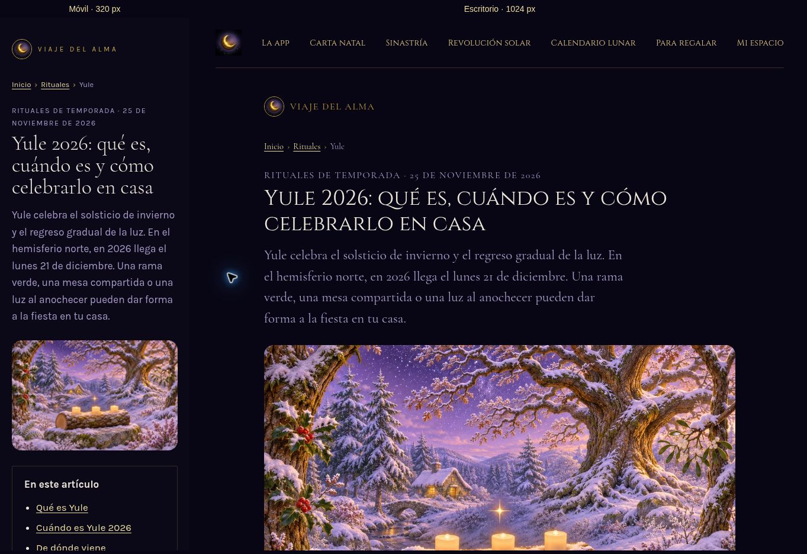

# SEO-2511-YULE

Artículo gratuito en `/rituales/yule/`, preparado desde `main` (`fd49ba20cac0945653dbf4aba2bdb150c5a5566c`). No se ha desplegado ni activado ninguna venta.

## Contenido

- Título: **Yule 2026: qué es, cuándo es y cómo celebrarlo en casa | Viaje del Alma**.
- Descripción (152 caracteres): **Descubre qué es Yule, cuándo cae el solsticio de invierno de 2026 y cómo celebrarlo en casa con siete gestos sencillos, símbolos e historia con fuentes.**
- 1.378 palabras de cuerpo, incluyendo título, fecha y encabezados. 1.540 contando índice, llamadas a la acción y pies de imagen. No se incluyen fuentes, redes ni navegación global.
- Texto original a partir del dossier YULE-1311 y las revisiones YULE-2311-MANU y YULE-2411-V2. No reproduce los capítulos del producto.
- Diciembre: 21-dic-2026, 20:50 UTC / 21:50 península. Comprobado en el Observatorio Astronómico Nacional y USNO. Junio: 21-jun-2027, 14:10 UTC, contrastado en Time and Date; se advierte del cambio de fecha en algunos husos del Pacífico.
- Historia situada y límites de las fuentes explícitos; siete propuestas domésticas contemporáneas. Fuentes enlazadas al final del artículo.

## Imágenes

Procedencia: `YULE-2411-IMG_v2.zip`, 24-nov-2026. Conversión a WebP de 1200 × 800, sin recortar la composición. Primera imagen con prioridad alta; las otras dos con carga diferida y dimensiones declaradas.

| Original v2 | Archivo web | Uso | Bytes |
| --- | --- | --- | ---: |
| YULE2_P01_v1.png | yule-bosque-invierno.webp | Cabecera, Open Graph y Twitter | 363032 |
| YULE2_P20_v1.png | corona-acebo-papel.webp | Símbolos | 321600 |
| YULE2_P14_v1.png | tronco-yule-luces.webp | Gestos domésticos | 291220 |

## Integración

Se conserva la plantilla de Samhain, su navegación, tipografías, colores, GoatCounter y hoja de escritorio. Ajuste local de ancho de lectura y de los enlaces sociales para evitar desbordamiento a 320 px. La portada añade un bloque breve al final de «Mi práctica diaria». Samhain enlaza la siguiente fiesta. El sitemap incorpora Yule y actualiza las páginas modificadas.

Canonical propia, `index,follow,max-image-preview:large`, Open Graph, Twitter Card, Article y BreadcrumbList. Sin FAQPage ni HowTo. «Rituales» enlaza el bloque real `/#rituales`; no se inventa una página `/rituales/` que devuelva 404. Samhain no tiene formulario de correo: no se añade uno.

Las dos llamadas a la app llevan `o=seo-yule` y `utm_source=web&utm_medium=seo&utm_campaign=yule`. Los UTM son necesarios porque `/app/` solo interpreta `o=web`; su comportamiento existente conserva los UTM hasta Play y `/web/`. No se modifica `/app/`. Los dos enlaces directos a Play llevan los mismos UTM dentro de `referrer`. Clics diferenciados por posición en GoatCounter.

La invitación a la guía empieza con `hidden` y usa **la configuración comercial de la PR 61**, `/yule/config.js`, mediante `VdaYule.estadoVenta`. No duplica fechas ni claves de activación. Solo aparece con PDF listo, enlace de pago válido y fecha anterior a `FIN_VENTA`; vuelve a comprobar el estado cada segundo, al restaurar la página y al recuperar visibilidad. El cierre aprobado es el 7-ene-2027 a las 00:00 de Madrid. Si la PR 61 aún no está desplegada, esa petición devuelve 404 y la invitación sigue oculta; el artículo gratuito permanece legible e indexable. No se habilita el cobro en esta PR.

## Validación

- `node --test tests/*.test.cjs`: **16/16**, diez pruebas existentes y seis nuevas. Incluyen metadatos, descubrimiento, enlaces, guardas de venta y propagación real de campaña a través del código de `/app/`.
- Integración local con `config.js` de PR 61, commit `7b6a90f98348dcedf34a5618be5ea923a880ddf2`: **8/8** escenarios (borrador, PDF ausente, pago ausente, pago inválido, venta, segundo anterior al cierre, cierre exacto, posterior). Ninguna petición a Stripe.
- `git diff --check`: correcto. IDs y anclas locales sin duplicados ni destinos inexistentes. Imágenes locales comprobadas.
- Chrome: vista de 320 px y escritorio de 1024 y 1363 px. `scrollWidth === clientWidth` en las vistas de 320 y 1024 px. Índice usable, imágenes cargadas al desplazarse y guía oculta sin configuración.
- Las vistas de 320 y 1024 usan marcos de comprobación locales, con barra de desplazamiento ocultada solo en la herramienta de prueba; no se añaden al sitio. No se ha probado en un Android físico.

[Captura adicional de escritorio](yule-escritorio.jpg).

## Revisión y publicación

Pendiente: aprobación editorial de Gemma y revisión del diff por Luna, fusión y solicitud de indexación. Las fechas editoriales del borrador son 25-nov; al publicar, alinear `datePublished`, `dateModified`, `article:published_time`, `article:modified_time`, fecha visible y `lastmod` con la fecha efectiva de publicación. No se garantiza indexación ni posición.
