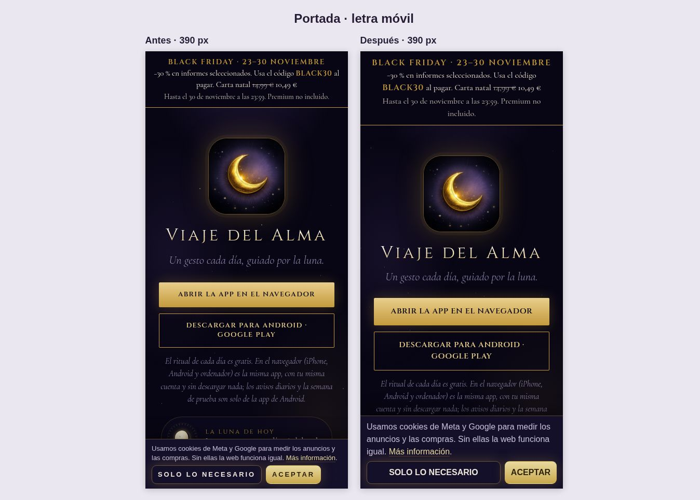
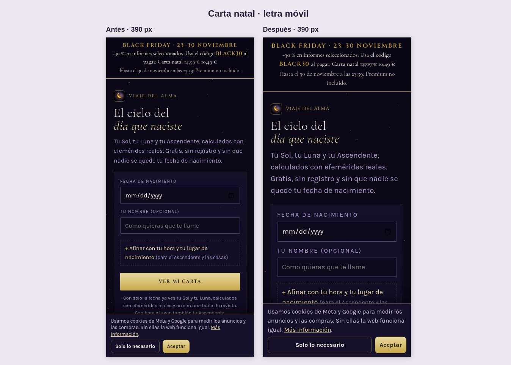
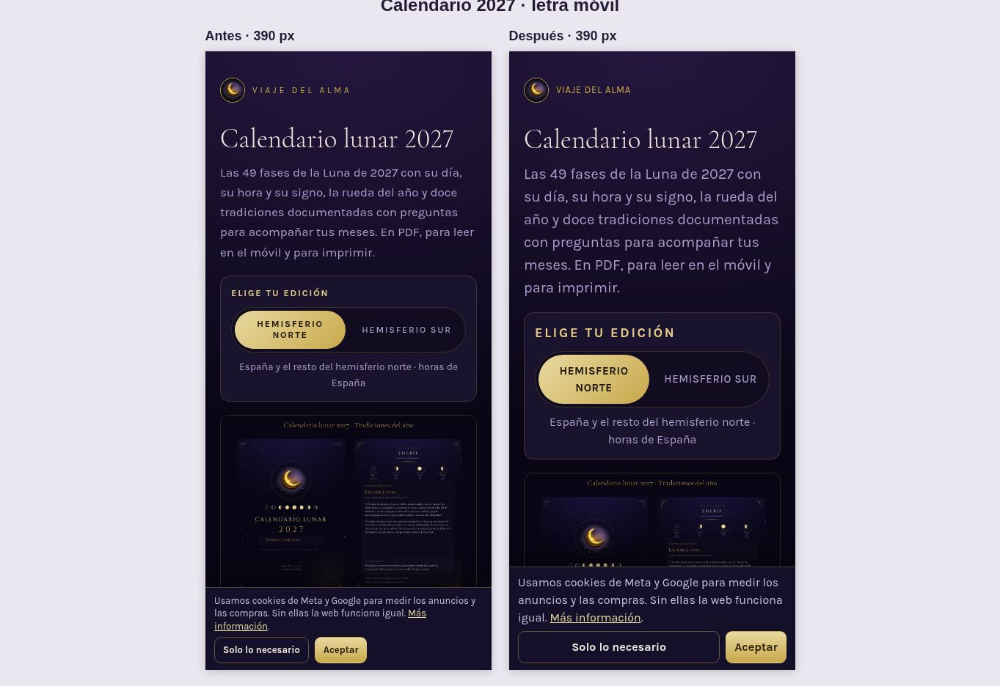
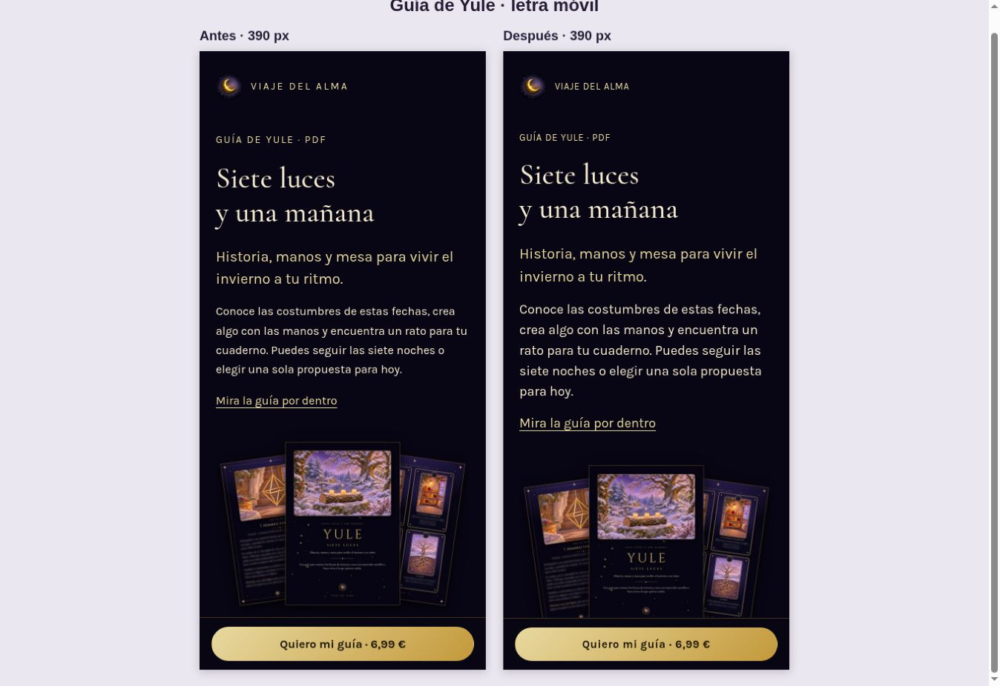
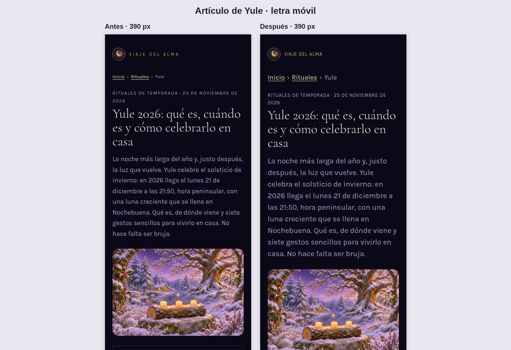

# WEB-NOV-2711 · Letra móvil · 27 de noviembre de 2026

Base: `9630c984fbe20572beff76fa0532e4acc01b4bf8`. Rama `letra-movil`. PR en borrador, independiente de `portada-novedades`.

`/movil.css?v=20261127-1` se carga con `media="screen and (max-width: 1023px)"`; sus reglas están también encerradas en esa media query y usan `body[data-vda-page]`. Cormorant de lectura: 20 px; Karla: 18 px; notas, tablas y etiquetas de formulario: 16 px; botones: mínimo 15 px; rótulos y chips: mínimo 13 px. Interlineado de lectura 1,55.

Son **51 HTML con `data-vda-page`**, no 50. Cada HTML recibe solamente el enlace a la hoja. Dos de ellos (`resumen/ajustes/index.html` y `yule/gracias-3d3dddbec7/index.html`) no tenían `escritorio.css`; se incluyen por tener el atributo, sin añadirles estilos de escritorio. `/web/`, `/web-prueba/` y `/vision-board/` quedan fuera.

Se da espacio al texto ampliado: índice de portada en una columna a 520 px o menos, miniaturas de carta en dos columnas, botones de cookies sin salir del viewport, y vista previa de la tarjeta regalo con altura natural. La frase de Samhain cerrado puede partirse; los importes conservan su línea. La impresión del regalo y el escritorio mantienen su diseño.

## Medición a 390 px

| Página | Antes <16 px | Después <16 px | Antes <18 px | Después <18 px |
|---|---:|---:|---:|---:|
| Portada | 50.6 % | 21.3 % | 85.4 % | 60.7 % |
| /carta/ | 67.0 % | 18.3 % | 82.2 % | 55.8 % |
| /calendario-2027/ | 53.7 % | 3.7 % | 91.9 % | 49.3 % |
| /yule/ | 44.9 % | 7.7 % | 85.9 % | 37.2 % |
| /rituales/yule/ | 31.9 % | 5.2 % | 86.2 % | 32.8 % |

Método: recuento de elementos renderizados con texto propio directo (no el texto de todos sus descendientes), excluyendo SVG, scripts, elementos ocultos y contenido de acordeones cerrados. Incluye toda la altura de la página y los avisos visibles de cookies/Black Friday. Cada elemento pesa uno; no es un porcentaje ponderado por caracteres. Antes y después se midieron con el mismo criterio, fuentes cargadas y ancho CSS de 390 px. Los porcentajes pueden diferir de los de Luna por el criterio de recuento. Las fracciones que siguen por debajo de 16/18 son principalmente rótulos, botones y notas permitidos por la escala; en las cinco páginas no queda texto por debajo de 13 px.

Datos: [CSV](mediciones-390.csv), [recuentos y distribución de tamaños](mobile-final.json), [escritorio](desktop-final.json), [51 páginas a 320 px](sweep-final.json).

## Capturas antes/después

Cada columna de las comparativas tiene un viewport CSS de 390 px; el ancho total del archivo incluye los dos marcos y sus rótulos. Son capturas de Chrome, sin recomponer ni modificar el contenido de la página.

### Portada

### /carta/

### /calendario-2027/

### /yule/

### /rituales/yule/

## Validación y límites

- Barrido de los 51 documentos a 320 px: 0 textos visibles por debajo de 13 px, 0 desbordes horizontales. Las plantillas de redirección se inspeccionan en copias de prueba con la navegación automática detenida; sus redirecciones no cambian en el repositorio.
- Cinco páginas a 1536 px: 622 elementos de texto comparados; 0 diferencias de tamaño, familia, interlineado o límites horizontales. La hoja móvil no interviene.
- Tarjeta regalo a 320 px con nombre largo y dedicatoria de 300 caracteres: 20 px en la dedicatoria, sin solapamiento ni desborde. No se envió formulario ni se realizó compra.
- `node --test --test-concurrency=1 tests/*.test.cjs`: 35/35. En una ejecución paralela, el test existente de IDs de compra falló porque compara el orden de finalización de dos hashes asíncronos (`tests/measurement.test.cjs:113`); pasó al ejecutar en serie. No se modifica ese test ni `meta.js`.
- `git diff --check`: correcto; comprobación automática de que los 51 HTML solo añaden una línea.
- No se añade ni modifica `noindex`, contenido comercial, precios o lógica de cobro.

Pendiente: revisión del diff y de las capturas, y fusión autorizada. No se ha publicado en producción.
