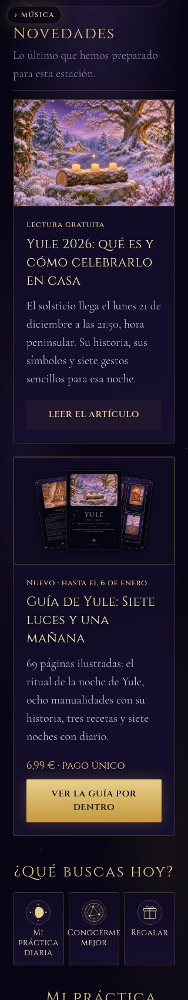
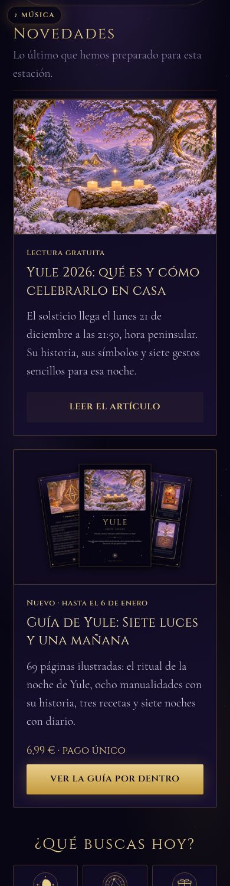
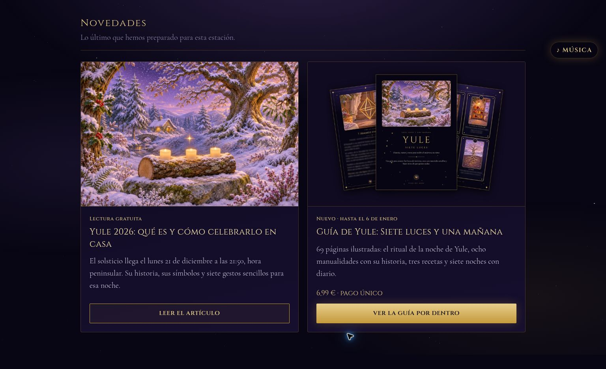
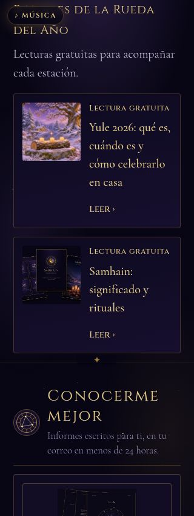
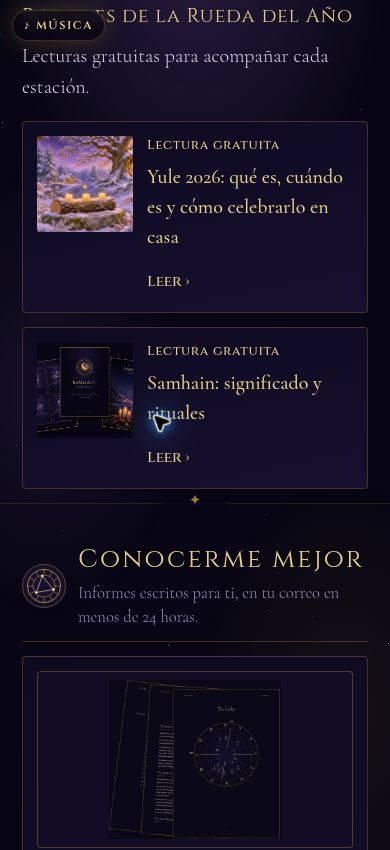
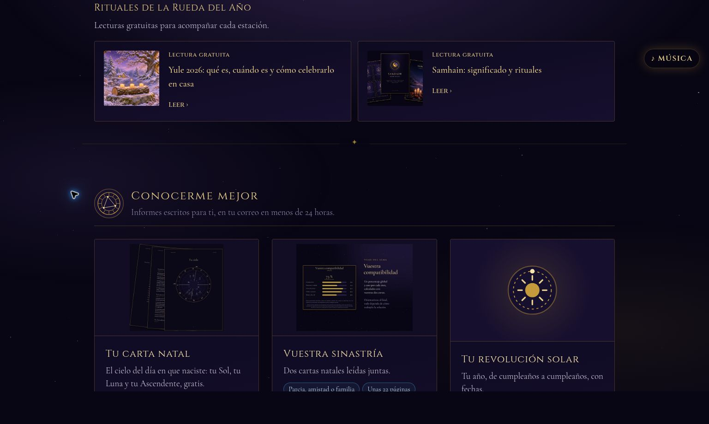
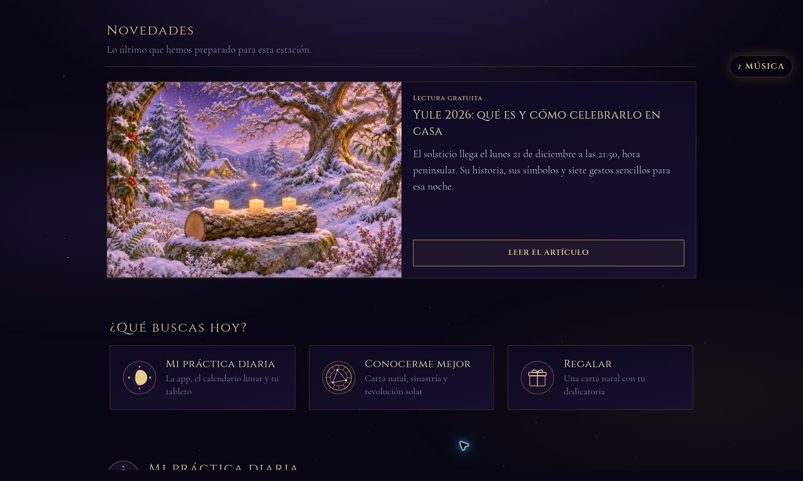

# WEB-NOV-2711 · Portada · 27 de noviembre de 2026

Base: `9630c984fbe20572beff76fa0532e4acc01b4bf8`. Rama `portada-novedades`. PR en borrador, sin fusionar.

Novedades aparece entre la cabecera y «¿Qué buscas hoy?». Conserva literalmente el texto aprobado. La guía reutiliza `/yule/config.js` y `/rituales/yule/guia.js`: `hidden` de origen, solo visible en estado `venta`, revisión cada segundo y al recuperar la pestaña. Sin configuración o después del cierre queda oculta y el artículo ocupa todo el ancho. No se añade lógica comercial duplicada.

La imagen de la guía es la composición existente `/yule/img/guia_por_dentro_700.webp` (700 × 526). El bosque usa 1200 × 800 y Samhain 1200 × 750. Las cuatro tarjetas son enlaces completos, con foco visible y los cuatro eventos GoatCounter solicitados. `lastmod` de `/`: 2026-11-27. No se añade `noindex`.

## Capturas

Capturas reales de Chrome en marcos con ancho CSS de 320, 390 y 1536 px. Se rechazan las cookies para ver las tarjetas completas; su diseño no cambia en esta PR. Las capturas altas de móvil muestran las dos tarjetas apiladas. El control flotante de música ya existía.

### Novedades · 320 px

### Novedades · 390 px

### Novedades · 1536 px

### Rueda del Año · 320 px

### Rueda del Año · 390 px

### Rueda del Año · 1536 px

### Venta cerrada · 1536 px

## Validación

- `node --test tests/*.test.cjs`: 35/35.
- `git diff --check`: correcto.
- Venta abierta: ambas tarjetas; cierre simulado a 7-ene-2027 y configuración ausente: guía oculta.
- Artículo solo en escritorio: 1128 px, el ancho completo del contenedor.
- 320 px: sin desborde en las tarjetas, precio completo y botones que pueden ocupar dos líneas.
- Ambas PR juntas a 320 px: cuatro tarjetas, ancho del documento 320 px.

Pendiente: revisión del diff por Luna y revisión visual/fusión por la propietaria. No se ha publicado en producción.
